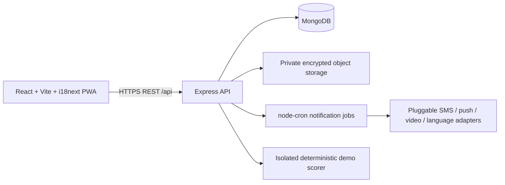

# Aarogya Drishti

AAROGYA DRISHTI is an AI-assisted oral healthcare management **demonstration platform** for rural and tribal healthcare workflows. All demonstration content and data must be synthetic. It includes authentication and role-based workflows for patient registration, screenings, appointments, referrals, medicine reminders, SOS, language/voice assistance, telemedicine, notifications, analytics, and settings.

> **Demonstration safety:** do not enter real patient information. AI output is simulated, is not for clinical use, does not diagnose, and must always be professionally reviewed.

## Architecture



The client uses React Router and responsive Tailwind/CSS styles. The server is layered into routers, controllers, validation, MongoDB-backed services, and adapters. Private photos and referral documents are encrypted before storage and are streamed only through authorized endpoints.

## Requirements

- Node.js 22 or later and npm
- MongoDB Community Server 8 or Docker Desktop with Docker Compose

## Local development

1. Copy `.env.example` to `.env`. For a local unauthenticated MongoDB instance, set `MONGODB_URI=mongodb://127.0.0.1:27017/aarogya_drishti`. If using the authenticated Compose MongoDB container while running the API on the host, use `mongodb://<MONGO_INITDB_ROOT_USERNAME>:<MONGO_INITDB_ROOT_PASSWORD>@127.0.0.1:27017/aarogya_drishti?authSource=admin`. Replace all example secrets before use beyond a local demo. Replace `STORAGE_ENCRYPTION_KEY` with a cryptographically random 32-byte key encoded as 64 hexadecimal characters; retain its key ID and back up the key separately.
2. Start MongoDB Community Server locally, or use `docker compose up -d mongo minio`.
3. Install dependencies from the repository root: `npm install`.
4. Create required MongoDB indexes: `npm run migrate`.
5. Optionally seed synthetic records: `npm run seed`.
6. Create the first Super Admin once using the environment variables described in [Admin account setup](#admin-account-setup).
7. Start both applications: `npm run dev`.
8. Open `http://localhost:5173` (or `http://localhost:5174` if Vite selects its fallback because port 5173 is occupied); the API liveness check is `http://localhost:4000/healthz`.

In local development, set `PATIENT_DEMO_OTP_ENABLED=true`. Patient OTPs are random, logged only to the backend development console, and never returned to the browser. The demo mode is disabled automatically outside `NODE_ENV=development`.

To show the WhatsApp contact button, set `VITE_WHATSAPP_NUMBER` in the root `.env` to the organization's public WhatsApp number with its country code (digits only, for example `91XXXXXXXXXX`), then restart Vite. This client-side setting is public, not a secret. The button opens WhatsApp with a generic, language-aware message; the user must choose to send it. It does not send patient data or automatically deliver messages. Leave it empty to hide the button.

The full container stack starts MongoDB, runs idempotent index setup and the synthetic seed, then starts the API: `docker compose up --build`. Create the first Super Admin once after the stack is ready using the setup command below. Compose persists MongoDB data and local encrypted screening-image objects in separate volumes. The default development storage driver is `local`; to use MinIO, set `STORAGE_DRIVER=s3` and retain `STORAGE_AUTO_CREATE_BUCKET=true` for local demonstration only. Use `STORAGE_AUTO_CREATE_BUCKET=false` with a pre-provisioned production bucket. MongoDB schema evolution is additive and uses idempotent indexes; destructive rollback is intentionally unsupported. Use `npm run migrate:status` to verify indexes and `npm run db:check` to verify the database. The API reference is available at `/api-docs/` and the machine-readable OpenAPI document at `/api-docs/openapi.json`.

### Admin account setup

The seed does not create login-ready Admin or Super Admin accounts. On a fresh database, set one-time setup values in your PowerShell session and run `npm run admin:bootstrap` from the repository root:

```powershell
$env:SUPER_ADMIN_SETUP_NAME = "KAMARAJU"
$env:SUPER_ADMIN_SETUP_EMAIL="korraraju5506@gmail.com"
$env:SUPER_ADMIN_SETUP_MOBILE = "9876543210"
$env:SUPER_ADMIN_SETUP_PASSWORD = "Raju@123@123"
npm run admin:bootstrap
Remove-Item Env:\SUPER_ADMIN_SETUP_NAME
Remove-Item Env:\SUPER_ADMIN_SETUP_EMAIL
Remove-Item Env:\SUPER_ADMIN_SETUP_MOBILE
Remove-Item Env:\SUPER_ADMIN_SETUP_PASSWORD
```

The bootstrap refuses to run if a Super Admin already exists, hashes the password with bcrypt, and writes an audit event. Do not place setup credentials in source control or reusable environment files. After signing in, a Super Admin can create Admin accounts from the **Create Admin Account** link or administrator management page; each new account remains inactive until explicitly approved. Admins can sign in with their username, email, or mobile number. Public registration and promotion to Super Admin are blocked. Admin password recovery requires a verified email OTP and a configured email provider.

The seed creates synthetic records only and does not provide hardcoded demo credentials. It retires legacy seeded admin accounts and assigns random, undisclosed passwords to seeded staff fixtures. On an existing database that was previously seeded with a demo Super Admin, run the seed once before bootstrapping so that the legacy account is retired. Doctors must use the registration and approval workflow for accounts they intend to use. Phone numbers and patient names are intentionally fake and must not be used to contact anyone. Do not enter real patient information.

Patients can self-register using a verified mobile number, then sign in with their mobile number and password; the existing patient OTP sign-in remains available. Passwords are bcrypt-hashed, and the local HTTP development server uses non-Secure, HTTP-only refresh cookies so sessions work on localhost. Production deployments must use HTTPS and Secure cookies. The existing staff-led patient registration flow remains available separately.

Run all tests with `npm test`, lint with `npm run lint`, and build the client with `npm run build`.

The current full suite covers unit/integration behavior, role-route smoke checks, localization parity, and encrypted-storage snapshot integrity. The end-to-end patient workflow, a live database restore drill, and 80% service coverage remain deployment/release gates; see [`docs/DEPLOYMENT.md`](./docs/DEPLOYMENT.md) and [`docs/BACKUP.md`](./docs/BACKUP.md). The route checker validates all 117 documented business routes.

### Research consent and governance

Research participation is unavailable by default. A patient can review the research notice and their append-only consent history at `/patient/research-consent`; a separate explicit checkbox is required for the `research_ai_training` purpose. The backend accepts and applies research consent only when `RESEARCH_GOVERNANCE_ENABLED=true`, an institutional approval reference, governance body, contact, and approved retention/withdrawal policy are configured, and the separate HMAC pseudonymization key is present. Configure these values only after the institution has approved the protocol and participant-facing information; the application does not independently verify approvals. Never fabricate these values.

Withdrawal blocks future enrollment, API visibility, annotation, and dataset sealing for linked research items. It does not delete or alter clinical records, and it cannot recall data already exported or analyses already completed. Do not export participant images; any retention or deletion must follow the actual approved institutional policy. This feature does not establish legal compliance or clinical validation.

### Patient and doctor authentication

Patients can self-register with a mobile number verified by a six-digit OTP, then sign in with their mobile number and password or use the existing OTP login. Self-registration stores the patient account and profile, including email, age, address, emergency contact, optional medical history, and explicit data-collection consent, in MongoDB. Passwords are bcrypt-hashed. Doctors submit their email with the registration request without an email OTP; their email is not marked verified by the system. Doctor accounts remain inactive until an administrator reviews and approves the request.

For local demonstrations only, set `PATIENT_DEMO_OTP_ENABLED=true` and optionally `PATIENT_DEMO_OTP_CODE=123456` in the server environment while `NODE_ENV=development`. Patient OTP sign-in, self-registration, and password-recovery screens then display the returned code beside **DEMO MODE – NOT REAL SMS VERIFICATION**; the code is never sent as SMS, is stored only as an HMAC hash, expires after five minutes, and allows at most five attempts. The default local test code is `123456`. Demo verification is disabled outside development and must never be enabled in production. The self-registration endpoint `POST /api/patient/send-otp` fails closed when demo mode is unavailable and never falls back to SMS. Patient OTP challenges have a 30-second resend cooldown and rate limits. Patient registration uses `POST /api/patient/send-otp` and `POST /api/patient/verify-otp`; verification returns a one-time registration token consumed after account details and consent are submitted. `POST /api/patient/login` creates the password-based session; the existing OTP login routes remain available. Never use real patient information in this demonstration.

For other direct Twilio SMS notifications, set `SMS_PROVIDER=twilio`, `TWILIO_ACCOUNT_SID`, and `TWILIO_AUTH_TOKEN`, then provide either `TWILIO_MESSAGING_SERVICE_SID` or `TWILIO_FROM_NUMBER`. Configure the Twilio account and any required Indian sender/DLT approvals before testing with a real phone. For an existing compatible SMS JSON endpoint, set `SMS_PROVIDER=custom`, `SMS_PROVIDER_URL`, and `SMS_PROVIDER_TOKEN`; the request includes `to`, `message`, and an idempotency key. Email OTP is still used for administrator password recovery; configure server-only `OTP_EMAIL_PROVIDER_URL` and `OTP_EMAIL_PROVIDER_TOKEN` in `.env` for those flows. The endpoint must accept an authenticated JSON `POST` with `to`, `subject`, and `text`, and be authorized to deliver from its configured sender. Set `OTP_HASH_SECRET` to a strong random secret for email OTPs. Missing or failed provider delivery never produces a development OTP.

Role-based access is enforced by the API using each account's role permissions; frontend route and navigation guards mirror those permissions but are not the security boundary. Super Admins use the separate `/super-admin` dashboard to manage accounts, doctor approvals, audit logs, system settings, and role permissions. Permission changes are audited, increment the role permission version, and revoke affected users' refresh sessions. Existing users and sessions are migrated/revalidated at API startup when the permission catalog changes. Patient records are scoped to the signed-in patient, assigned doctor/PHC, health-worker area, or specialist referral, and patient profile/history and screening record reads are audited.

### Admin workspace

Super administrators and administrators can access `/admin` for the synthetic-data dashboard, `/admin/users` for user management, `/admin/reports` for CSV/PDF/JSON exports, and `/admin/audit-logs` for audit review. Super administrators also have `/admin/administrators`. Admin-created temporary passwords are shown once and require a password change at next sign-in. Global system settings remain reserved for Phase 11.

### Patient management and offline use

Staff with the permitted role can use `/patients` to search records and `/patients/register` to register a patient. Health workers, doctors, and admins can open `/patients/sync-status` to review queued registrations and securely hand off temporary passwords. Offline patient registrations require manual sync so credentials are not lost or persisted in plaintext; the same client UUID permits safe retries. The facility names supplied for this project are selectable labels only and have not been independently verified. Appointment booking reads the exact 39-name allowlist from active MongoDB hospital/PHC records via `GET /api/appointments?directory=true`; it offers doctors only when their existing profiles are assigned to the selected facility. No demo doctor/facility affiliations are seeded. To apply the catalog in a development database, run `npm run seed:facilities`; it is idempotent, non-production-only, and retires only the prior deterministic demo facility records without deleting appointment history. Do not run this command against production. Verified facility records and doctor assignments must be maintained through approved administrative workflows before real-world use. Location fields allow free-text values. The PWA caches the app shell and offline suggestions, not patient API responses. Use only synthetic information; do not enter real patient details on any device.

The seed includes a near-duplicate test profile, **Demo Patient 1A**, in Demo Village 1. Submitting a similarly named record with the same seeded mobile number and village exercises the duplicate-review flow. The seed mobile numbers are synthetic test values and must never be used to contact anyone.

Appointment requests are stored as `booked` (pending facility confirmation); only the assigned doctor or an administrator can confirm them. Available times come from a doctor's configured availability and are checked again by the API on submission. If no times are configured, booking remains unavailable and the user is directed to contact the facility. For local demonstrations only, `npm run seed:appointment-demo --workspace server` assigns five clearly labeled synthetic demo doctors and sample schedules to the first five catalog facilities. It requires the development demo users and facility seed, is disabled in production, and must never be treated as real staffing or availability.

### Oral screening and demonstration analysis

Patients can start their own screening from the dashboard; doctors and health workers can continue to create screenings for their assigned patients. The patient flow records separate data-collection, photo-storage, and optional Gemini-processing consents. A patient may continue without Gemini consent, but no image is sent to Google; consent can be granted later from the screening report. Patient image uploads must pass quality checks and be retaken if flagged, while staff workflows retain the explicit low-quality override. Images are checked for type and quality, stripped of EXIF/GPS data, encrypted before storage, and served only through an authorized no-store image stream. Health workers may save drafts and selected images to the offline screening queue; patient screening submission requires an online connection.

When Gemini is configured and the patient separately consents, sanitized image bytes are sent to Gemini for preliminary visual observations. Questionnaire answers are not sent to the vision model and remain separately labelled as patient-reported. Gemini is a general-purpose model and is not clinically validated for oral disease screening; no risk category or disease probability is generated. The result records image-quality checks, inference status, provider/version, uncertainty, limitations, and requires clinician review. Poor-quality images skip inference and provider failures are stored as failures. Without Gemini configuration, the questionnaire-only demonstration is clearly labelled, produces no medical score, and never claims image analysis.

After image capture and upload, a patient can choose an active doctor and submit a human-review request. The doctor inbox separates assigned requests from other screenings; doctors can mark a request `under_review` and respond through the existing clinical-review form. Patients can view the assigned doctor, request status (`submitted`, `under_review`, or `responded`), and the completed clinical review, including observations, review notes, recommended investigations, referral advice, and optional follow-up recommendation/date. Request submission requires active data-collection and photo consent plus an uploaded image; it does not depend on AI success or AI consent. The assigned doctor receives patient scope only for the requested case. The workflow currently supports photos only, not video. AI observations remain preliminary; final diagnosis and treatment decisions must be made by a qualified clinician.

### Appointments, referrals, reminders, and SOS

Patients and staff can manage authorized appointments and referrals, use localized medicine reminders, and view notification history. Emergency SOS requires explicit confirmation and location consent. The interface offers a direct call to 108; it never dispatches an ambulance automatically.

### Languages, voice, telemedicine, and reports

English, Telugu, Hindi, and Odia are available throughout the interface. Browser speech tools are optional and have text fallbacks. Translation output carries a clinician-review notice. The optional Gemini chatbot requires the server-side `GEMINI_API_KEY` setting and accepts text only; do not submit identifying or private patient information. The oral-image screening integration sends decrypted, metadata-stripped oral image bytes to Google Gemini only after separate, auditable `ai_processing` consent; questionnaire responses are not sent with the images. Do not enable real-patient use without reviewing applicable Google data-processing terms and obtaining informed consent. Gemini uses `gemini-3.5-flash-lite` by default, configured through `GEMINI_MODEL`; older `gemini-2.5-flash` access is deprecated and limited. If Gemini is not configured, the clearly labelled rules-based demonstration does not analyze images. All AI output is preliminary and not for clinical use; it cannot confirm or exclude disease or determine cancer stage, and diagnosis requires qualified examination and appropriate investigations. Telemedicine joins a Jitsi room for each scheduled audio/video appointment. Patients and doctors can turn their microphone and camera on or off; either participant can optionally share their screen. The browser requests device and screen-capture permission at the point of use. Local development may use public `meet.jit.si`; production blocks call preparation and joining unless a non-public Jitsi domain, app ID, and JWT secret are configured. Configure the same `VIDEO_DOMAIN` for the API and client container so the browser's CSP and Permissions Policy permit only that meeting host.

The Home Page voice copilot uses the browser's speech recognition and speech synthesis where supported, with editable text input as a fallback. Speech recognition may require an internet connection even when the copilot's bundled four-language oral-health FAQ is available offline. Online answers use the public `/api/copilot/chat` endpoint and the server-side Gemini key; health status exposes only whether that key is configured. The session conversation is held in browser memory and is not saved. Do not enter names, contact information, patient IDs, or private medical records. Online AI is educational and can be unavailable even while internet is connected; offline responses are labelled and limited to the bundled FAQ.

### Encrypted backups

Set a strong `BACKUP_PASSPHRASE` (at least 16 characters, kept separately from backup files). Run `./scripts/backup.sh` to create encrypted MongoDB and private local-storage snapshots. Restore only into an isolated recovery database and empty storage directory with `RESTORE_CONFIRM=replace ./scripts/restore.sh <database-backup> <storage-snapshot>`. Read [`docs/BACKUP.md`](./docs/BACKUP.md) before restoring.

## Documentation and screenshots

- [`docs/API.md`](./docs/API.md), [`docs/ERD.md`](./docs/ERD.md), and Swagger UI at `/api-docs/`
- [`docs/SECURITY.md`](./docs/SECURITY.md), [`docs/BACKUP.md`](./docs/BACKUP.md), and [`docs/DEPLOYMENT.md`](./docs/DEPLOYMENT.md)
- [`docs/USER_GUIDE.md`](./docs/USER_GUIDE.md), [`docs/IMAGE_CREDITS.md`](./docs/IMAGE_CREDITS.md), and [`docs/TRANSLATION_REVIEW.md`](./docs/TRANSLATION_REVIEW.md)

Screenshots are not included in this repository yet; no live application/database was available in this environment to capture verified screens.

## Safety and scope

This is a demonstration platform, not a clinical product. Do not enter real patient information. AI screening is preliminary only, not for clinical use, and must never be treated as a diagnosis, cancer confirmation, or cancer stage. The questionnaire-only demo must be labelled `DEMO AI OUTPUT – NOT FOR CLINICAL USE.` and must not generate medical scores or image findings. Gemini image observations require separate consent and must not run when consent is absent; Gemini is not clinically validated for oral disease screening.
