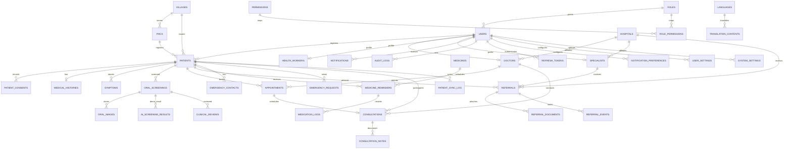
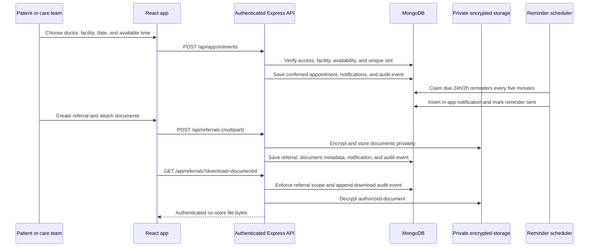

# Architecture

The project is a React/Vite client and a Node.js/Express REST API with MongoDB, private encrypted image storage, and an isolated rule-based demonstration AI module.

The server is organized under `server/src` into middleware, database, services, repositories, validators, controllers, routes, jobs, storage, and AI modules. Client presentation lives under `client/src` and uses React Router, i18next, Tailwind CSS, and reusable UI components.

## Database

MongoDB connectivity, collection indexes, and database health checks are managed in `server/src/db/mongo.js`. Collections use string UUID identifiers and snake_case fields to preserve the REST API contract. Index setup is idempotent and managed by `npm run migrate`; destructive schema rollback is not supported. Production deployments must configure MongoDB authentication and least-privilege application credentials.



## Screening and private image flow

The screening feature is implemented as six REST routes backed by validators, controllers, a service, and dedicated image-storage, image-quality, and demo-AI adapters. Screening and image operations check data-collection/photo consent and enforce ownership, health-worker assignment, and specialist referral scope at the service layer.

```mermaid
sequenceDiagram
  participant Staff as Doctor or health worker
  participant Client as React screening workflow
  participant API as Authenticated Express API
  participant DB as MongoDB
  participant Store as Private encrypted storage
  participant AI as Demo AI adapter
  Staff->>Client: Select patient and record symptoms
  Client->>API: POST /api/screenings (client_uuid)
  API->>DB: Verify assignment and active data consent; save screening and audit
  Staff->>Client: Capture or select oral image
  Client->>API: POST /api/screenings/:id/upload-image
  API->>DB: Verify assignment and photo consent
  API->>API: Validate signature, quality, strip EXIF/GPS
  API->>Store: Store AES-256-GCM ciphertext with unique IV
  API->>DB: Save opaque key, encryption metadata, hash, and quality
  Staff->>API: POST /api/screenings/:id/ai-analysis
  API->>AI: Score synthetic signals using deterministic demo rules
  AI-->>API: Demo-only category and safety disclaimer
  API->>DB: Save result as is_demo=true and audit
  Staff->>API: POST /api/screenings/:id/clinical-review
  API->>DB: Save review, referral recommendation, notification, and audit
  Client->>API: GET /api/screenings/:id?image_id=...
  API->>Store: Decrypt authorized image and verify SHA-256
  API-->>Client: Authenticated no-store inline image bytes
```

The client uses a screening-specific IndexedDB queue for offline drafts. It stores a stable `client_uuid`, retries with bounded exponential backoff, and submits drafts when connectivity returns. Authenticated screening responses and decrypted image URLs are not cached by the service worker.

## Language and voice support

The public language catalog and authenticated preference/translation routes are mounted from the language module; voice routes use memory-only upload handling and pluggable speech adapters. The React app keeps a first-run language choice in local storage and synchronizes it to the authenticated user and linked patient profile. A reusable browser speech-recognition hook powers the voice page and screening symptom entry, while typed input remains available. Provider-independent oral-health explanations and simple instructions use curated language strings; any translation includes a clinician-review notice.

## Appointment and referral flow

Appointment availability is held with each doctor as weekday-to-time-slot JSON in India local time. Booking validates patient ownership/assignment, facility relationships, and slot availability; a unique partial MongoDB index prevents duplicate active `(doctor_id, scheduled_at)` bookings. Appointment changes are audited, with notifications stored as separate MongoDB documents. Because local MongoDB may run as a standalone server, multi-document writes are not atomic. The five-minute `node-cron` worker creates due reminder notifications and uses persisted appointment markers for best-effort deduplication.

Referral documents reuse the private encrypted-storage adapter. The database stores opaque object keys, AES-256-GCM metadata, content hashes, safe filenames, and MIME types; document reads require an authorized referral relationship, decrypt only on request, and append an audit event. Referral status, specialist feedback, and follow-up are retained as chronological `referral_events` entries.

## Phase 11 notification and telemedicine services

Modules use the shared `services/notificationService.js` for localized in-app records and configured SMS/push delivery. It honors per-type and per-channel preferences and quiet hours; emergency notifications remain enabled. The appointment and medicine jobs retain their existing deduplication markers, while a minute scheduler locks consultation and referral follow-up records before creating due reminders.

The consultation service checks appointment mode, participant ownership, and recorded teleconsultation consent before creating a random provider room. `adapters/video.js` signs short-lived participant JWTs; neither room URLs nor tokens are persisted. The consultation list exposes availability only; a separate join action returns credentials just in time to an authenticated appointment patient or doctor during the appointment window. Provider display names are role labels rather than patient-identifying names. Analytics uses scoped MongoDB aggregation pipelines, and export requests are permission-checked and audited. Settings persist user preferences in MongoDB; system settings remain super-admin-only.



## Medicine and emergency flows

Medicine, reminder, log, and emergency endpoints use separate validators, controllers, and services. Medicine dose timestamps are built from `HH:mm` values in `Asia/Kolkata` and stored as UTC instants. The one-minute scheduler uses persisted reminder state to avoid duplicate work where possible, extends a seven-day log horizon, creates in-app notifications, and marks pending doses missed after two hours. These operations span MongoDB documents and are not atomic on a standalone server. SMS and push adapters use configured provider URLs and stable idempotency keys; delivery is optional and follows both reminder channel and notification preferences.

SOS requests are saved with consent-checked coordinates, audit records, and in-app notices for active administrators and the patient's PHC health workers. Only after explicit request consent and provided coordinates can an SMS contain a map link. The service limits emergency contacts to five per patient. Nearby facility search uses Haversine distance for supplied coordinates and the patient's district otherwise. No server job or route dispatches an ambulance; the client provides `tel:108`.

MongoDB writes that span multiple documents or collections are not transactional in the local standalone deployment; a failure can leave partial effects. Services use unique indexes, idempotency keys, and persisted markers where available, but this does not provide general multi-document atomicity. Deployments must account for this limitation and use failure/retry-safe workflows.
