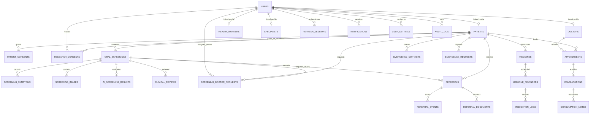

# Entity relationship overview

This conceptual diagram shows principal MongoDB collection relationships; reference/catalog collections and audit fields are omitted for readability. MongoDB connection and index definitions are maintained in [`server/src/db/mongo.js`](../server/src/db/mongo.js).

Patient photographs and referral files are represented by opaque storage keys, encryption metadata, and content hashes. The corresponding bytes live in the private storage adapter and are not exposed as public URLs. See [`SECURITY.md`](./SECURITY.md) for access and key-handling details.

`screening_doctor_requests` links one patient-owned screening to its selected doctor and records its `submitted`, `under_review`, or `responded` state and timestamps. Its unique screening index prevents duplicate requests; doctor/status and patient/date indexes support the isolated inboxes. Starting a request requires active data-collection and photo consent and an uploaded image. A request grants only the selected doctor access to that patient for the requested screening. Clinical reviews remain in `clinical_reviews`, with optional follow-up recommendation and date fields.

`research_consents` is a separate append-only participant-consent event collection. Each event references the patient and user, records the purpose, consent version, language, status, sequence, grant timestamp, and (for withdrawal events) withdrawal timestamp. A unique patient/sequence index makes concurrent consent state changes conflict instead of silently reordering the history. Withdrawal blocks matching `research_dataset_items`; it does not delete or update clinical records.

Sealed `research_datasets` store `manifest_version`, `manifest_algorithm`, `manifest_hash`, and `manifest_item_count`. The hash covers stable, de-identified manifest fields and expert annotation provenance; reads verify the digest before returning any export. The unique `research_dataset_items.id` index and unique dataset/image index protect item identity and enrollment idempotency. Curation tests use the opt-in `npm run test:research-mongo --workspace server` only with an isolated, loopback MongoDB database named `aarogya_drishti_research_test_*`; test fixtures are not governance approval.
